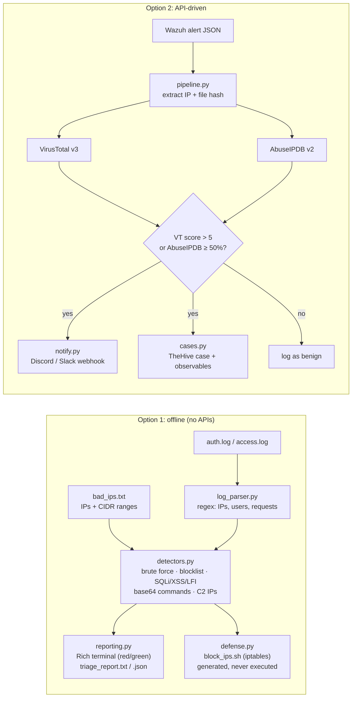

# Blue Team Auto-Triage

> **A 3AM-approved SOC automation pipeline.** Hunt through raw logs offline, or take a Wazuh alert, enrich it with VirusTotal + AbuseIPDB, ping the team on Discord/Slack and open a TheHive case, in one command.

   

The tool has two modes:

| Mode | Command | Needs internet / keys? | What it does |
|---|---|---|---|
| **Option 1: Offline hunt** | `python main.py hunt` | No | Parses `auth.log` and web access logs, matches a local IP blocklist, detects brute force, SQLi/XSS/LFI, base64-encoded commands and hidden C2 IPs, and writes reports plus an `iptables` block script |
| **Option 2: Alert pipeline** | `python main.py alert` | Optional (`--mock` for demo) | Reads a Wazuh alert, enriches the IP and file hash, decides severity, sends a Discord/Slack alert and opens a TheHive case |

---

## Screenshots

**Option 1: offline hunt** (`python main.py hunt`)


**Option 2: alert pipeline** (`python main.py alert --mock --dry-run`)


---

## Architecture



---

## Quick start

```bash
git clone https://github.com/<your-username>/Blue-Team-Triage-Tool.git
cd Blue-Team-Triage-Tool
python -m venv .venv && source .venv/bin/activate      # Windows: .venv\Scripts\activate
pip install -r requirements.txt
```

Run both demos (sample data included, no keys needed):

```bash
python main.py hunt
python main.py alert --mock --dry-run
```

Run the tests (unit, HTTP integration, E2E, fuzzing, ReDoS and performance; see [docs/TEST_PLAN.md](docs/TEST_PLAN.md)):

```bash
pip install -r requirements-dev.txt
python -m pytest --cov=triage
```

---

## Option 1: Offline log hunt

```bash
python main.py hunt                                   # sample logs in data/
python main.py hunt /var/log/auth.log /var/log/nginx/access.log
python main.py hunt --threshold 10 --allow 192.168.1.0/24 --fail-on high
```

| Flag | Meaning |
|---|---|
| `--bad-ips FILE` | Local blocklist, one IP or CIDR per line, `#` for labels (default `data/bad_ips.txt`) |
| `--threshold N` | Failed SSH logins from one IP before it counts as brute force (default 5) |
| `--allow IP/CIDR` | Never generate block rules for this range (your admin VPN, office, monitoring). Repeatable |
| `--fail-on SEVERITY` | Exit code 1 if anything at or above `low/medium/high/critical` is found (for cron/CI) |
| `--out-dir DIR` | Where reports go (default `output/`) |
| `--svg FILE` | Also save the terminal output as an SVG screenshot |

**Outputs** (in `output/`):
- `triage_report.txt`: human-readable summary of how many attacks were found and what they were
- `triage_report.json`: the same data for other tools or a SIEM
- `block_ips.sh`: idempotent `iptables`/`ip6tables` rules (`-C … || -A …`) with undo commands. **Review it before running `sudo bash output/block_ips.sh`.**

### Detection rules

| Rule | Severity | Trigger |
|---|---|---|
| `COMPROMISE_SUSPECTED` | critical | Successful SSH login from an IP that already had ≥ N failures |
| `LOGIN_FROM_BAD_IP` | critical | Successful SSH login from a blocklisted IP |
| `SSH_BRUTE_FORCE` | high | ≥ N failed logins from one IP (named *password spraying* when ≥ 3 usernames are tried) |
| `BAD_IP_MATCH` | high | IP appears in `bad_ips.txt` (exact or CIDR match) |
| `SQL_INJECTION` | high/medium | `UNION SELECT`, `' OR '1'='1`, `AND 1=1`, stacked `; DROP TABLE`, `SLEEP()`, `information_schema` |
| `PATH_TRAVERSAL` | high | `../../`, `/etc/passwd`, `win.ini` |
| `XSS` | medium | `<script`, `javascript:`, `onerror=` |
| `SCANNER_USER_AGENT` | medium | sqlmap, nikto, nmap, gobuster, wpscan, nuclei, … |
| `BASE64_PAYLOAD` | high/low | Base64 that decodes to readable text; **high** if it is a shell command (`bash -i`, `/dev/tcp`, `curl … \| sh`, PowerShell, …) |
| `C2_INDICATOR` | high | An IP hidden *inside* a decoded payload; gets an **outbound** block rule |

Requests are URL-decoded up to three times first, so `%2527` (double-encoded `'`) is still caught.

---

## Option 2: API-driven alert pipeline

### 1. Configure keys

```bash
cp .env.example .env
```

Then fill in `.env`:

| Variable | Where to get it | Required? |
|---|---|---|
| `VT_API_KEY` | [virustotal.com](https://www.virustotal.com) → profile → API key (free: 4 lookups/min, 500/day) | Yes for live mode |
| `ABUSEIPDB_API_KEY` | [abuseipdb.com](https://www.abuseipdb.com) → Account → API | Optional |
| `DISCORD_WEBHOOK_URL` | Discord channel → Edit Channel → Integrations → Webhooks | Optional |
| `SLACK_WEBHOOK_URL` | Slack app → Incoming Webhooks | Optional |
| `THEHIVE_URL`, `THEHIVE_API_KEY` | TheHive 5 → user settings → API key | Optional |
| `VT_MALICIOUS_THRESHOLD` | Alert when VirusTotal malicious engines **>** this (default 5) | Optional |
| `ABUSEIPDB_CONFIDENCE_THRESHOLD` | Alert when AbuseIPDB confidence **≥** this (default 50) | Optional |

`.env` is in `.gitignore`, so your keys never reach GitHub.

### 2. Run

```bash
python main.py alert --mock --dry-run              # demo: fake API answers, payloads saved, nothing sent
python main.py alert --dry-run                     # real lookups, but don't post to Discord/TheHive yet
python main.py alert                               # full pipeline on data/dummy_alert.json
python main.py alert /var/ossec/logs/alerts/alerts.json   # Wazuh's NDJSON file works too
python main.py alert data/benign_alert.json --mock # a clean alert: no notification, no case
```

| Flag | Meaning |
|---|---|
| `--mock` | VirusTotal/AbuseIPDB answers come from `data/mock_intel.json` (same JSON shape as the real APIs) |
| `--dry-run` | Build the Discord, Slack and TheHive payloads and save them to `output/dry_run/` instead of sending |
| `--no-notify` / `--no-case` | Turn off chat notification / case creation |
| `--env-file FILE` | Use a different `.env` |

### What happens

1. **Extract IOCs**: `data.srcip` / `dstip` and the strongest file hash from `syscheck` (SHA256 → SHA1 → MD5, so one lookup instead of three). Internal IPs (RFC 1918) and the agent's own IP are never sent to external APIs.
2. **Enrich**: VirusTotal (IP + hash) and AbuseIPDB (IP). A built-in rate limiter respects the free tier (4 requests/min).
3. **Decide**:

   | Severity | Condition |
   |---|---|
   | critical | VT and AbuseIPDB both flag it, or VT malicious ≥ 4× threshold |
   | high | VT malicious > threshold **or** AbuseIPDB confidence ≥ threshold |
   | medium | some detections, but below the thresholds |
   | low | nothing found |

4. **Escalate** (high/critical only): a Discord embed and/or Slack Block Kit message, plus a TheHive case (severity, TLP:AMBER, tags, MITRE IDs, a markdown table of intel, a checklist of recommended actions) with the IP and hash added as observables.

The sample alert uses the [EICAR test file](https://www.eicar.org/download-anti-malware-testfile/) hash, so a real VirusTotal key returns a genuine high detection count without touching real malware.

---

## Security notes

Logs are attacker-controlled input, so the tool treats them that way:

- **No IP spoofing via usernames.** `ssh "x from 1.2.3.4 port 22"@server` writes a fake IP into `auth.log`. The parser always takes the *last* `from <ip> port <n>`, which sshd appends itself.
- **Only validated IPs reach `iptables`.** Every address passes through Python's `ipaddress` before it goes into a command, so `1.2.3.4; rm -rf /` can never land in `block_ips.sh`.
- **Nothing is auto-executed.** The block script is generated for a human to review. Loopback/multicast are never blocked, and `--allow` protects your own ranges.
- **No terminal injection.** ANSI escapes, newlines and bidi characters from logs are stripped before printing, and log text is never parsed as Rich markup.
- **No mention spam.** Discord payloads set `allowed_mentions: {parse: []}` and Slack text is escaped, so a crafted alert can't `@everyone`.
- **Secrets stay secret.** Keys live in `.env` (git-ignored), are hidden from `repr()`, and webhook errors never echo the URL (the URL is itself a token).

---

## Project structure

```
Blue-Team-Triage-Tool/
├── main.py                 # CLI: `hunt` (Option 1) and `alert` (Option 2)
├── triage/
│   ├── log_parser.py       # Phase 1: line-by-line parsing, regex IP/user extraction
│   ├── intel.py            # Phase 2: bad_ips.txt loader (IPs + CIDR)
│   ├── detectors.py        # Phase 2: all detection rules
│   ├── reporting.py        # Phase 3: Rich terminal output, .txt/.json reports
│   ├── defense.py          # Phase 4: iptables script generation
│   ├── config.py           # .env / environment settings
│   ├── enrichment.py       # VirusTotal + AbuseIPDB clients, rate limiter, mock mode
│   ├── notify.py           # Discord / Slack webhooks
│   ├── cases.py            # TheHive 5 case + observables
│   └── pipeline.py         # Option 2 orchestrator
├── data/
│   ├── auth.log, access.log        # sample logs telling one attack story
│   ├── bad_ips.txt                 # sample blocklist (documentation IP ranges)
│   ├── dummy_alert.json            # mock Wazuh alert: attacker IP + EICAR hash
│   ├── benign_alert.json           # mock alert that should NOT escalate
│   └── mock_intel.json             # fake VT/AbuseIPDB responses for --mock
├── tests/                  # 122 tests: unit, integration, E2E, fuzzing, ReDoS, performance
├── docs/                   # screenshots + TEST_PLAN.md
├── .env.example
└── requirements.txt
```

All sample IPs come from the RFC 5737 documentation ranges (`192.0.2.0/24`, `198.51.100.0/24`, `203.0.113.0/24`), so no real host is accused.

---

## Ideas to extend

- Time-window brute-force detection (e.g. 10 failures in 60 seconds) using the syslog timestamps
- Watch mode (`tail -f`) for live log streams
- Jira instead of TheHive in `cases.py`
- GeoIP enrichment for the offline mode (MaxMind GeoLite2 database, still no API)
- Run `alert` from a Wazuh integration script so every level ≥ 10 alert is triaged automatically
