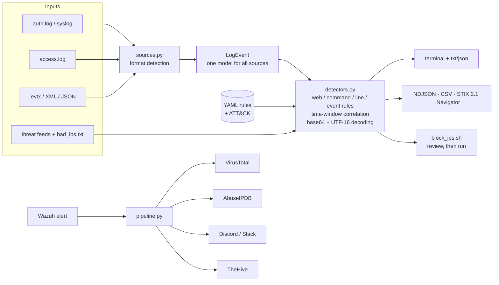

<p align="center"></p>

<h1 align="center">OwlTriage</h1>
<p align="center"><b>Sees in the dark. Triages before you wake up.</b></p>

One command turns raw Linux, web and Windows logs into an **owl's summary of what happened and what to do next**, ATT&CK-mapped findings, IOCs and ready-to-review firewall rules. It runs offline, its detections are YAML that anyone can write, and it gives you a 3AM-approved first look before you open the SIEM.

[](https://github.com/vinitrami-Soc/owltriage/actions/workflows/ci.yml)    

```bash
pip install "owltriage[evtx] @ git+https://github.com/vinitrami-Soc/owltriage"
owltriage hunt --demo
```

## What you get

The report opens with **the owl's summary**: the attack stories in plain sentences, and numbered next steps (accounts to reset, hosts to isolate, IPs to block, persistence to remove). Then come the evidence (findings with ATT&CK IDs and file:line), IP verdicts and a firewall script.


While a hunt runs, the owl from the logo hops onto the loading bar and walks with the real progress, turning its head and looking around whenever a big file slows things down. It adds about 1.5 seconds and only appears on an interactive terminal: never for pipes, cron, CI, `--quiet` or `--no-anim`. On small terminals it becomes a one-line `(◉▼◉)` walker.

## Why

| You are... | owltriage gives you |
|---|---|
| **An incident responder** on a box you just SSH'd into | A triage of `auth.log`, web logs or `Security.evtx` in seconds, with no agent, SIEM or internet |
| **A small team** without a SIEM | Scheduled hunts, free threat feeds and Discord/Slack alerts |
| **A Wazuh user** | Automatic VirusTotal/AbuseIPDB enrichment and TheHive cases for high-level alerts |
| **A detection engineer** | A place to write, test and share rules as YAML, with ATT&CK mapping enforced |
| **Learning blue team** | Bundled attack stories (Linux + web + Windows) that show what attacks look like in logs |

It is not a SIEM, an EDR or an auto-blocker. It reads logs you give it and tells you what it found and why.

## What it reads

| Source | Formats | Examples of what it catches |
|---|---|---|
| Linux auth / syslog | `auth.log`, `secure` | SSH brute force & spraying (time-windowed), login after brute force, sudo abuse, new users, sudo-group changes, reverse shells & `curl \| sh` in sudo commands |
| Web servers | Apache / Nginx combined | SQLi (UNION, tautology, stacked, time-based), XSS, path traversal, command injection, Log4Shell, Shellshock, `.env`/`.git` probes, scanner user-agents |
| Windows | `.evtx`, `wevtutil` XML (UTF-8/16), Winlogbeat & flat JSON | RDP/SMB/Kerberos brute force & spraying, DCSync, LSASS dumping (Sysmon 10, 4656/4663, comsvcs, procdump, rdrleakdiag), ntds.dit theft, Kerberoasting, log clearing, admin-group changes, suspicious services, PsExec, shadow-copy deletion, Defender tampering, PowerShell `-enc` / download cradles / obfuscated `IEX` (4688, Sysmon 1, **4104 ScriptBlock**) |
| Anything | IPs on your blocklist or downloaded threat feeds; base64 payloads (UTF-8 and PowerShell UTF-16) are decoded and re-scanned, and IPs hidden inside them are flagged as possible C2 | |

Formats are detected from the file content, so you can mix them in one run.

## Quick start

```bash
owltriage hunt --demo                                   # bundled Linux + web + Windows attack story
owltriage hunt /var/log/auth.log /var/log/nginx/access.log
owltriage hunt Security.evtx Sysmon.evtx --window 300   # needs the [evtx] extra
owltriage hunt logs/*.log --fail-on high --quiet         # cron / CI: exit 1 on high+
owltriage hunt big.evtx --no-anim                        # plain output, no owl
```

No `pip`? Run from a checkout: `pip install -r requirements.txt && python main.py hunt --demo`.
Docker: `docker build -t owltriage . && docker run --rm -v "$PWD:/work" owltriage hunt --demo`.

Windows without the `evtx` package: export first with `wevtutil qe Security /f:xml > security.xml`.

## Outputs

Every hunt writes to `./owltriage-output/` (change it with `--out-dir`):

| File | For |
|---|---|
| `triage_report.txt` | Humans: the owl's summary, findings, ATT&CK coverage, IP verdicts |
| `triage_report.json` | Scripts (includes the summary: stories and next steps) |
| `findings.ndjson` | **Elastic / Splunk / Wazuh / Graylog**: one ECS-style JSON per finding (`rule.*`, `threat.technique.*`, `source.ip`) |
| `iocs.csv` | Spreadsheets, firewall and EDR import |
| `iocs.stix.json` | **MISP / OpenCTI**: a STIX 2.1 bundle with deterministic IDs, so re-imports update instead of duplicating |
| `attack_layer.json` | **ATT&CK Navigator**: open it at mitre-attack.github.io/attack-navigator to see a heat map of what happened |
| `block_ips.sh` | `iptables`/`ip6tables` rules (inbound for attackers, outbound for C2). Idempotent, with undo commands. **Generated, never executed.** |

## Detection as code

All 59 detections are YAML in [`owltriage/rules/`](owltriage/rules/). Each one carries ATT&CK IDs and its own tests:

```yaml
- id: cmd-inhibit-recovery
  name: RANSOMWARE_PRECURSOR
  title: Backups / shadow copies deleted
  type: command
  severity: critical
  mitre: [T1490]
  pattern: '\bvssadmin(?:\.exe)?\b.{0,50}\bdelete\s+shadows\b|\bwmic(?:\.exe)?\b.{0,50}\bshadowcopy\s+delete\b'
  tests:
    match:    ["vssadmin.exe delete shadows /all /quiet"]
    no_match: ["vssadmin list shadows"]
```

```bash
owltriage rules list                     # what is loaded
owltriage rules test                     # 160+ examples, also run in CI
owltriage hunt logs/ --rules-dir ./my-rules   # add rules, or tune / disable built-ins by id
```

Tuning without forking, in `my-rules/tuning.yml`:

```yaml
- id: auth-brute-force
  threshold: 10
  window_seconds: 300
- id: win-kerberoasting
  enabled: false
```

Rule types (`web`, `command`, `line`, `event`, `correlation`) and the quality checklist are covered in **[docs/RULES.md](docs/RULES.md)**.

## Threat feeds (optional)

```bash
owltriage update-feeds          # IPsum, abuse.ch Feodo Tracker, blocklist.de, Emerging Threats
owltriage update-feeds --list   # what is configured and how old the cache is
```

Feeds are cached under `~/.cache/owltriage/feeds` and loaded by every `hunt`, so hunts stay offline. Feeds can't flag private, reserved or wider-than-/8 ranges, so a broken feed never marks your LAN as malicious. Add your own feeds with `--feeds-config`. Check each provider's terms before commercial use.

## Alert enrichment (Wazuh → VirusTotal / AbuseIPDB → Discord / Slack / TheHive)


```bash
owltriage alert --demo                         # sample alert, fake API answers, nothing sent
cp .env.example .env                            # VT_API_KEY, ABUSEIPDB_API_KEY, webhooks, TheHive
owltriage alert /var/ossec/logs/alerts/alerts.json --dry-run   # real lookups, save payloads only
```

It pulls the attacker IP and the strongest file hash from the alert (internal IPs are never sent to external APIs) and enriches them within the VirusTotal free-tier rate limit. When a score crosses the threshold (VT > 5 or AbuseIPDB ≥ 50 % by default) it posts a Discord embed / Slack message and opens a TheHive case with observables. Every alert is logged to `alert_results.ndjson`. To run it automatically from Wazuh, see **[docs/WAZUH.md](docs/WAZUH.md)**.

## Architecture



## Built to read hostile input

Logs are written by attackers, so the parsers assume the worst:

- **No auto-execution.** Firewall rules go to a script for a human, and only `ipaddress`-validated IPs are written into it. `--allow` protects your own ranges.
- **No IP spoofing via usernames.** `ssh "x from 1.2.3.4 port 22"@host` can't make the tool blame 1.2.3.4.
- **No terminal or report injection.** ANSI escapes, `\r`, bidi characters and Rich markup from logs are neutralised.
- **Safe parsers.** XML goes through `defusedxml` (no DTDs or entity bombs), YAML through `safe_load`, and regexes only see bounded input with bounded quantifiers.
- **Safe chat.** Discord `allowed_mentions` is empty and Slack text is escaped, so a crafted alert can't `@everyone`. Payloads respect the Discord size limits, so alerts aren't silently rejected.
- **Secrets stay put.** Keys stay in `.env`, are hidden from `repr()`, and webhook URLs never appear in errors.

Details are in [SECURITY.md](SECURITY.md).

## Validation

- **Unit, integration and E2E tests**: CLI subprocess tests, a local fake VirusTotal/Discord/TheHive over real HTTP, the generated `block_ips.sh` executed against a fake `iptables`, Hypothesis fuzzing, ReDoS and performance tests. See [docs/TEST_PLAN.md](docs/TEST_PLAN.md).
- **Real attack recordings**: CI runs every rule against the ~280 files in [EVTX-ATTACK-SAMPLES](https://github.com/sbousseaden/EVTX-ATTACK-SAMPLES). No file may crash the parser, and a list of known attacks (DCSync, Kerberos spraying, LSASS dumps, ntds.dit theft, …) must stay detected.
- **Speed**: roughly 30k text log lines/s and 9k EVTX records/s on one core with all 59 rules, with flat memory (streaming).

## Limitations

- It reads files. For a live view use `--fail-on` from cron, or the Wazuh integration.
- Signatures catch known patterns, not everything. A quiet result is not proof of a clean host.
- Detection on Windows depends on what you audit. Enable Sysmon, process command-line auditing (4688) and PowerShell Script Block Logging (4104) for the best coverage.
- The Wazuh integration and Docker image follow the official docs but still need field reports from real deployments.

## Contributing

Rules, false-positive reports and new log parsers are all very welcome. See [CONTRIBUTING.md](CONTRIBUTING.md), [docs/RULES.md](docs/RULES.md) and the issue templates. MIT licensed.
